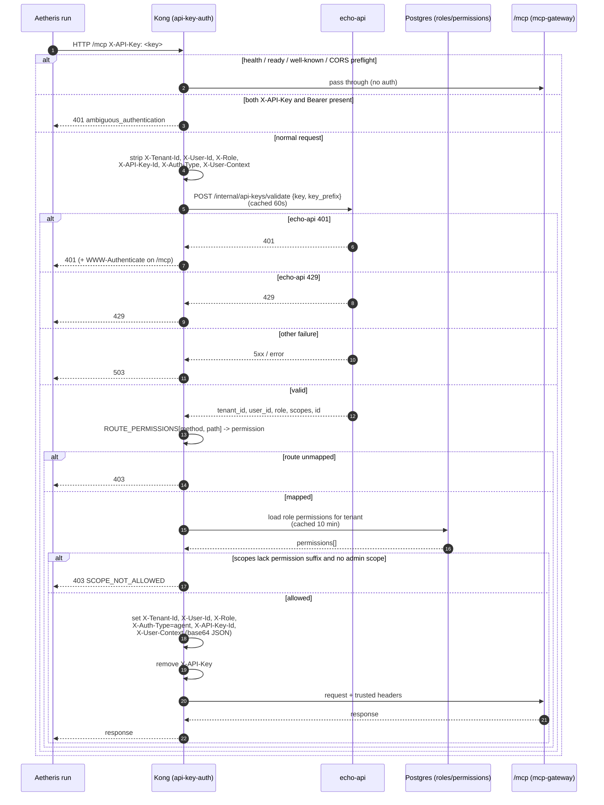
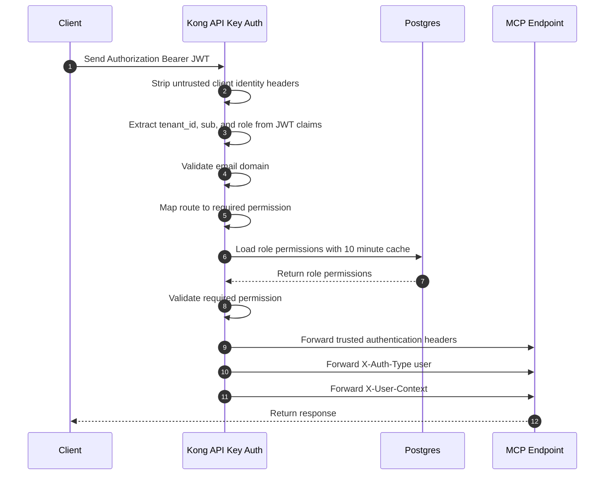

# Echo/Kong user-context flow for the Bank Statement MCP


How a caller's credential becomes the trusted user context that reaches `/mcp`
(and so the Bank Statement agent). 

Aetheris side: see `README.md` and `config.exs` in this directory. Aetheris only
sends a credential header; it never builds, decodes or forwards `X-User-Context`.

## 1. Principle

All identity work happens at the Kong edge. Downstream services, including
`/mcp`, never see the API key. They trust headers Kong sets after
authentication and RBAC.

## 2. Actors

| Actor | Role |
|---|---|
| Aetheris run | Sends `X-API-Key` or `Authorization: Bearer` only |
| Kong (`api-key-auth` post-function) | Authenticates, runs RBAC, sets trusted headers, strips the key |
| echo-api | Validates API keys (`/internal/api-keys/validate`) |
| Postgres | Holds `roles`, `role_permissions`, `permissions` per tenant |
| mcp-gateway / `/mcp` and other services (campaign, credits) | Trust Kong's headers; read tenant from `X-Tenant-Id` |

## 3. API-key flow (`X-API-Key`)

1. **Skip list.** Kong skips health, ready and well-known paths and CORS preflight.
2. **Ambiguity check.** If both `X-API-Key` and `Authorization: Bearer` are sent,
   Kong returns `401 ambiguous_authentication`.
3. **Strip client identity headers** so they cannot be spoofed:
   `X-Tenant-Id`, `X-User-Id`, `X-Role`, `X-API-Key-Id`, `X-Auth-Type`, `X-User-Context`.
4. **Validate the key.** `POST http://echo-api.api.svc.cluster.local/internal/api-keys/validate`
   with `{key, key_prefix}`. Cached 60 s. Returns `tenant_id`, `user_id`, `role`,
   `scopes`, `id`.

   | echo-api result | Edge result |
   |---|---|
   | 401 | 401 |
   | 429 | 429 |
   | anything else | 503 |
5. **RBAC, before headers are set.**
   - `ROUTE_PERMISSIONS` maps method + path to a required permission. For `/mcp`:
     `GET` -> `mcp.read`; `POST`, `PUT`, `PATCH`, `DELETE` -> `mcp.write`.
     An unmapped route gets `403`.
   - The role's permissions are loaded directly from the Postgres `roles`,
     `role_permissions` and `permissions` tables for the tenant. Cached 10 min.
   - The key's `scopes` must include the permission's suffix (e.g. `read`), or the
     key must have the `admin` scope. Otherwise `403 SCOPE_NOT_ALLOWED`.
6. **Set trusted upstream headers, then remove `X-API-Key`.**

   | Header | Value |
   |---|---|
   | `X-Tenant-Id` | tenant from validation |
   | `X-User-Id` | user from validation |
   | `X-Role` | role from validation |
   | `X-Auth-Type` | `agent` |
   | `X-API-Key-Id` | key `id` |
   | `X-User-Context` | base64 JSON `{tenant_id, user_id, role, auth_type, permissions[]}` |

### Sequence diagram



## 4. JWT flow (`Authorization: Bearer`)

Same flow as above, except:

- Kong reads `tenant_id`, `sub` (user) and the role from the Bearer token claims;
  there is no call to `/internal/api-keys/validate`.
- Kong also checks the email domain.
- `X-Auth-Type` is `user`.
- No `X-API-Key-Id` is sent.



## 5. `X-User-Context` shape

Base64-encoded JSON generated only by Kong:

```json
{
  "tenant_id": "...",
  "user_id": "...",
  "role": "...",
  "auth_type": "agent",
  "permissions": ["mcp.read", "mcp.write", "..."]
}
```

`auth_type` is `agent` for API keys and `user` for JWTs.

## 6. Downstream behaviour

- mcp-gateway, campaign, credits and similar services trust these headers and read
  the tenant from `X-Tenant-Id`. `X-User-Context` additionally carries the
  permissions list.
- The API key never reaches them.
- `/mcp` is the one exception to the plain 401: its 401 adds a `WWW-Authenticate`
  header pointing at the OAuth protected-resource metadata.

## 7. Error summary

| Condition | Status |
|---|---|
| Both `X-API-Key` and Bearer sent | 401 `ambiguous_authentication` |
| echo-api says key invalid | 401 |
| echo-api rate-limits | 429 |
| echo-api other failure | 503 |
| Route not in `ROUTE_PERMISSIONS` | 403 |
| Scope lacks permission suffix, no `admin` | 403 `SCOPE_NOT_ALLOWED` |

## 8. Caching

| Data | TTL | Consequence |
|---|---|---|
| API-key validation | 60 s | A revoked key can work up to 60 s |
| Role permissions (Postgres) | 10 min | Permission changes can take up to 10 min to apply |

## 9. Mapping to the Aetheris Bank Statement agent

| Step | Where |
|---|---|
| Launcher exports `BANK_STATEMENT_MCP_AUTH_TOKEN` or `BANK_STATEMENT_MCP_API_KEY` (exactly one) | run's process env |
| `config.exs` turns it into `Authorization: Bearer …` or `X-API-Key` headers on the `type: :http` entry | `config.exs` |
| Harness applies the headers to `tools/list` and `tools/call` | harness |
| Kong authenticates, runs RBAC, sets `X-User-Context` | this document |
| Backend returns tenant-scoped statements | Echo |

Aetheris rejects `X-User-Context` and `BANK_STATEMENT_MCP_HEADER_*` passthrough,
and never puts the credential in prompts, tool schemas or tool arguments.


